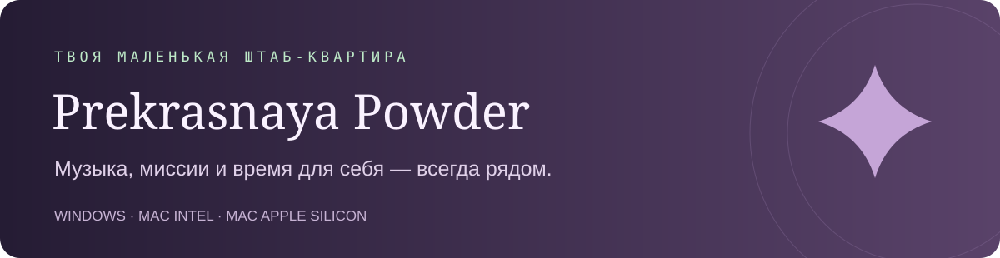
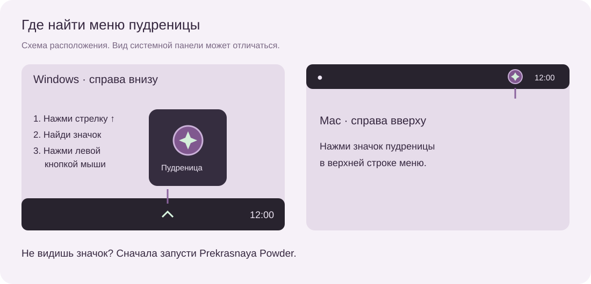
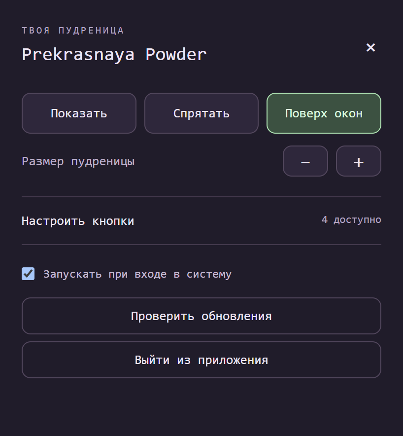
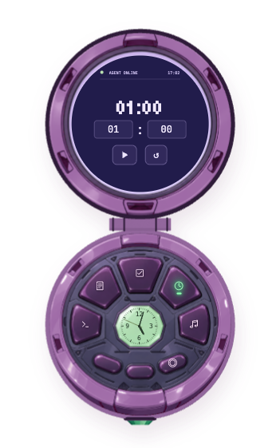
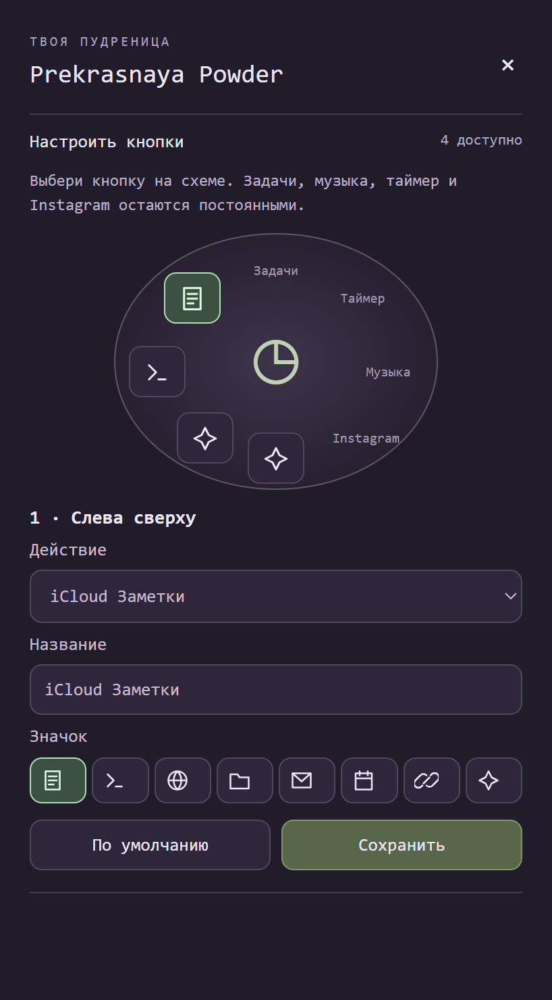

  

  Маленькая пудреница для твоего рабочего стола. 
  Включай музыку, записывай миссии и занимайся своим делом — всё нужное рядом.

  <a href="#скачать">Скачать</a> · <a href="#первые-шаги">Первые шаги</a> · <a href="#где-найти-управление">Где меню?</a> · <a href="#настрой-под-себя">Настроить кнопки</a>

## Скачать

**Бесплатно · версия 0.2.9 · аккаунт GitHub не нужен**

Выбери свой компьютер и нажми на ссылку. Скачивание начнётся сразу.

| Твой компьютер | Скачать один файл |
| :--- | :--- |
| **Windows 10 / 11** · Intel или AMD, 64 бита | **[↓ Установить для Windows](https://github.com/DariaPrekrasnaya/prekrasnaya-powder-releases/releases/download/v0.2.9/Prekrasnaya-Powder-Setup-0.2.9.exe)** |
| **Mac · чип Apple** · M1, M2, M3, M4 и новее | **[↓ Скачать для Mac с чипом Apple](https://github.com/DariaPrekrasnaya/prekrasnaya-powder-releases/releases/download/v0.2.9/Prekrasnaya-Powder-0.2.9-Mac-arm64.dmg)** |
| **Mac · Intel** | **[↓ Скачать для Mac с Intel](https://github.com/DariaPrekrasnaya/prekrasnaya-powder-releases/releases/download/v0.2.9/Prekrasnaya-Powder-0.2.9-Mac-x64.dmg)** |

На Mac открой **Apple → «Об этом Mac»**, чтобы узнать свой процессор. Нужна macOS 13 или новее. Пудреница работает на компьютере, не на iPhone или iPad.

> **Не нужно скачивать весь репозиторий.** Достаточно одного файла из таблицы. Кнопка Code, архив Source code и служебные файлы в разделе Assets для установки не нужны.

## Первые шаги

**На Windows**

1. Открой скачанный файл `Prekrasnaya-Powder-Setup-0.2.9.exe`.
2. Нажми «Установить» и дождись завершения.
3. Оставь галочку «Запустить Prekrasnaya Powder» и нажми «Готово».

**На Mac**

1. Открой скачанный файл `.dmg`.
2. Перетащи Prekrasnaya Powder в **Applications / «Программы»**.
3. Запусти пудреницу из «Программ».

<b>Компьютер показывает предупреждение при первом запуске?</b>

У приложения нет платного сертификата издателя Windows и проверки Apple. Поэтому система может показать предупреждение, даже если файл скачан с этой страницы.

На Mac после первой попытки запуска может появиться возможность разрешить приложение в **«Системные настройки → Конфиденциальность и безопасность → Всё равно открыть»**. Разрешай запуск только если сама скачала этот файл и доверяешь источнику. На рабочем компьютере могут действовать ограничения администратора. Отключать защиту системы целиком не нужно. [Инструкция Apple](https://support.apple.com/102445).

## Где найти управление

**Настройки и управление окном живут в маленьком значке возле системных часов.** Эта область Windows называется **трей**. На Mac — **строка меню**.

- **Windows:** посмотри вправо вниз, рядом с часами. Нажми стрелку **⌃**, найди значок пудреницы и щёлкни по нему **левой кнопкой мыши**. Иногда значок уже виден рядом с часами — тогда стрелка не нужна.
- **Mac:** нажми значок пудреницы справа в верхней строке меню.
- **Значка нет?** Запусти Prekrasnaya Powder через меню «Пуск» на Windows или из «Программ» на Mac.

Откроется такая панель:

| Кнопка | Что делает |
| :--- | :--- |
| **Показать** | Возвращает пудреницу на экран. |
| **Спрятать** | Убирает её с экрана; музыка и таймер продолжают работать. |
| **Поверх окон** | Позволяет видеть пудреницу поверх других приложений. Зелёная кнопка означает, что режим включён. |
| **− / +** | Уменьшает или увеличивает пудреницу. |
| **Настроить кнопки** | Открывает назначения четырёх свободных кнопок. |
| **Запускать при входе в систему** | Включает запуск вместе с компьютером. |
| **Проверить обновления** | Проверяет, появилась ли новая версия. |
| **Выйти из приложения** | Полностью закрывает пудреницу, включая музыку и таймер. |

**Крестик в углу панели закрывает только эту панель.** Чтобы убрать саму пудреницу и продолжить слушать музыку, нажми «Спрятать».

## Познакомься с пудреницей

- **Изумруд снизу** открывает и закрывает крышку. Закрытая крышка не останавливает музыку и таймер.
- **Перемещение:** зажми свободную область корпуса левой кнопкой мыши и потяни в удобное место. Для изменения размера используй − / + в меню.
- **Миссии:** добавляй задачи, листай список вверх и вниз. Нажатие на название открывает подробности; галочка отмечает выполнение и переносит миссию вниз. В подробностях есть «Назад».
- **Таймер:** задай минуты и секунды, нажми ▶. После запуска поля ввода скрываются. Отсчёт можно поставить на паузу.
- **Музыка:** выбирай плейлист, управляй воспроизведением и перематывай дорожку. Кнопка «Назад» возвращает к плейлистам. Музыка и сигнал таймера уже включены в установщик.
- **Радио:** «Радио · Radio Garden» открывает карту станций в отдельном окне. Нужен интернет; доступность станций зависит от сервиса.

## Настрой под себя

Четыре кнопки можно переназначить. **Задачи, таймер, музыка и Instagram автора остаются постоянными.**

1. Открой меню возле часов → **«Настроить кнопки»**.
2. Нажми нужную кнопку на схеме. Подсветка и подпись покажут, какую ты меняешь.
3. Выбери действие: приложение, сайт, файл, iCloud Заметки или терминал. Можно оставить кнопку пустой.
4. Задай название и выбери значок.
5. Нажми **«Сохранить»** — назначение сразу появится на пудренице.

**Хочешь открывать Claude или другое приложение?** Выбери «Установленное приложение» и найди его по названию. Само приложение должно быть уже установлено; файл Setup — это установщик, его выбирать не нужно.

«По умолчанию» возвращает исходное назначение только выбранной кнопки. Для iCloud нужен твой собственный вход; чужие задачи, заметки и аккаунты в установщик не входят.

## Обновления приходят сами?

Пудреница **сама проверяет новые версии после запуска и каждые 6 часов**, пока работает и есть интернет. Когда новая версия найдена, появится предложение обновиться. Постоянно нажимать «Проверить обновления» не нужно.

- **Windows:** нажми «Скачать обновление», затем «Перезапустить и установить». Оба шага можно отложить.
- **Mac:** нажми «Скачать для Mac», выйди из пудреницы через её меню, открой новый DMG и замени приложение в «Программах». На Mac замена выполняется вручную.

При ручной проверке сразу появляется «Проверяем обновления…». Ответ может занять несколько секунд. Если обновлений нет, появится сообщение «У тебя последняя версия».

Миссии, настройки и вход в iCloud хранятся отдельно от программы и сохраняются при обновлении. Не удаляй папку данных приложения.

---

Сделано Дарьей · для маленьких миссий и больших планов ✦ <a href="https://github.com/DariaPrekrasnaya/prekrasnaya-powder-releases/releases/latest">Последний выпуск</a> · <a href="https://github.com/DariaPrekrasnaya/prekrasnaya-powder-releases/releases">История обновлений</a>

